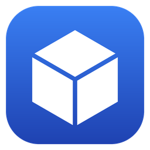

<div align="center">



# JustModIt Manager

The desktop companion of mod and translation sites built on JustModIt: it finds your games, installs what the site
offers for them, keeps it up to date and can undo every change.

[](https://github.com/GrzybDev/JustModIt-Manager/actions/workflows/ci.yml)
[](LICENSE.md)
[](https://github.com/GrzybDev/MenadzerSpolszczen/releases)


*Po polsku: [README.pl.md](README.pl.md)*

</div>

## About

JustModIt Manager is a Windows app for sites built on JustModIt, a platform for sites that host mods and translations of
games. It detects the games you installed through stores and launchers, installs and updates the projects (mods,
translations and the like) that the site offers for them, and keeps enough local state to undo every change, even
offline. Authors build their packages with its package creator. The app starts with Windows, lives in the system tray
and updates itself.

This repository holds the shared platform and the two apps built on it:

| App | For | Download |
|---|---|---|
| **Menadżer Spolszczeń** | [Baza Spolszczeń](https://bazaspolszczen.pl), the catalogue of Polish fan translations of games | [GrzybDev/MenadzerSpolszczen](https://github.com/GrzybDev/MenadzerSpolszczen/releases) |
| **JustModIt Manager** | any JustModIt site; it uses the Baza Spolszczeń catalogue until JustModIt has a site of its own | not released yet |

> [!TIP]
> Menadżer Spolszczeń 0.1.0 is the first public release. [Download it](https://github.com/GrzybDev/MenadzerSpolszczen/releases/latest),
> and if something doesn't work as it should, [let us know](SUPPORT.md).

## Features

- **Finds your games** in Steam, GOG (GOG Galaxy, offline installers, Heroic) and the Epic Games Store (Epic Games
  Launcher, Heroic, Legendary), and follows the stores' changes as they happen, without scanning your drives.
- **Installs with one click or automatically**, after checking that the package fits your version of the game, and
  never while the game runs or the store is updating it.
- **Keeps installs up to date**: new releases, optional add-ons of a release, and repairs after a game update
  overwrote the files.
- **Undoes everything**: the original files are kept, every change is journaled, and an interrupted install is rolled
  back after a crash or a power loss.
- **Light in the tray**: the background agent holds about 9 MB of memory when idle; the window is a separate process
  that exits when you close it.
- **Package creator** for authors: compares a folder of changed files with the game, picks the operations (copy,
  xdelta3 patch, rename, delete), checks them against the hosting rules and builds a package ready for the site.
- **Private by design**: no telemetry. Error reports are sent only with your consent, and you see what goes first.

## Documentation

| Document | What it covers |
|---|---|
| [docs/architecture](docs/architecture/README.md) | how the apps work and why |
| [docs/translating.md](docs/translating.md) | translating the apps into another language |
| [docs/package-format.md](docs/package-format.md) | the manifest package format for authors and tools |
| [docs/site-integration.md](docs/site-integration.md) | what a JustModIt site needs to work with the apps |
| [docs/releasing.md](docs/releasing.md) | versions, the release workflow and code signing |
| [CONTRIBUTING.md](CONTRIBUTING.md) | building, testing and the rules for code and commits |
| [SUPPORT.md](SUPPORT.md) | where to get help and report problems |
| [SECURITY.md](SECURITY.md) | how to report a vulnerability |

## Building from source

Requirements: Windows 10/11 x64, the [.NET SDK](https://dotnet.microsoft.com/download) from `global.json` (10.0.402),
and Visual Studio 2022/2026 or Build Tools with the "Desktop development with C++" workload for the native xdelta3 shim.

```bash
git clone --recurse-submodules https://github.com/GrzybDev/JustModIt-Manager.git
cd JustModIt-Manager
dotnet build JustModIt.Manager.slnx
dotnet test --solution JustModIt.Manager.slnx
dotnet run --project src/MenadzerSpolszczen
```

A development build uses a data folder, mutexes, a pipe and a link scheme of its own, so it runs beside an installed
copy without touching it. [CONTRIBUTING.md](CONTRIBUTING.md) has the details, including NativeAOT packaging.

## Contributing

Bug reports, ideas and pull requests are welcome. Please read [CONTRIBUTING.md](CONTRIBUTING.md) first, and follow the
[Code of Conduct](CODE_OF_CONDUCT.md).

## Licence

All code in this repository, including both apps, is free software under the
[GNU General Public License, version 3 or later](LICENSE.md).

The branding of Menadżer Spolszczeń is the exception: the names "Baza Spolszczeń" and "Menadżer Spolszczeń", their
logos, icons and other brand assets are not covered by the GPL (as section 7(e) permits), except that unmodified
official builds may be redistributed; see [its notice](src/MenadzerSpolszczen/Branding/LICENSE.md). The JustModIt
Manager logo is licensed like the code, so forks can ship it.

The third-party components that ship with the apps, and their licences, are listed in
[THIRD-PARTY-NOTICES.md](THIRD-PARTY-NOTICES.md).
