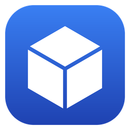

<div align="center">



# JustModIt Manager

Aplikacja towarzysząca stronom z modyfikacjami i spolszczeniami zbudowanym na JustModIt: znajduje Twoje gry, instaluje
to, co strona do nich udostępnia, aktualizuje to i potrafi cofnąć każdą zmianę.

[](https://github.com/GrzybDev/JustModIt-Manager/actions/workflows/ci.yml)
[](LICENSE.md)
[](https://github.com/GrzybDev/MenadzerSpolszczen/releases)


*In English: [README.md](README.md)*

</div>

## O projekcie

JustModIt Manager to aplikacja na Windows i Linuksa, także na Steam Decka, dla stron zbudowanych na JustModIt,
platformie dla serwisów z modyfikacjami i spolszczeniami gier. Wykrywa gry zainstalowane przez sklepy i launchery,
instaluje i aktualizuje projekty (mody, spolszczenia i podobne), które strona do nich udostępnia, i przechowuje dość
danych, by każdą zmianę dało się cofnąć, także bez internetu. Autorzy budują paczki w jej kreatorze paczek. Aplikacja
uruchamia się razem z systemem, działa w tle z ikoną w zasobniku systemowym, jeśli pulpit go ma, i sama się
aktualizuje.

To repozytorium zawiera wspólną platformę i dwie zbudowane na niej aplikacje:

| Aplikacja | Dla | Pobieranie |
|---|---|---|
| **Menadżer Spolszczeń** | [Bazy Spolszczeń](https://bazaspolszczen.pl), katalogu spolszczeń gier tworzonych przez fanów | [GrzybDev/MenadzerSpolszczen](https://github.com/GrzybDev/MenadzerSpolszczen/releases) |
| **JustModIt Manager** | dowolnej strony JustModIt; dopóki JustModIt nie ma własnej strony, korzysta z katalogu Bazy Spolszczeń | jeszcze bez wydań |

## Możliwości

- **Znajduje gry** ze Steama, GOG-a (GOG Galaxy, instalatory offline, Heroic) i Epic Games Store (Epic Games Launcher,
  Heroic, Legendary) i na bieżąco śledzi zmiany w sklepach, bez przeszukiwania dysków.
- **Instaluje jednym kliknięciem albo automatycznie**, po sprawdzeniu, że paczka pasuje do Twojej wersji gry, i nigdy
  wtedy, gdy gra działa albo sklep ją aktualizuje.
- **Aktualizuje**: nowe wydania, składniki wydań do wyboru i naprawy po aktualizacji gry, która nadpisała pliki.
- **Cofa wszystko**: oryginalne pliki są zachowywane, każda zmiana trafia do dziennika, a przerwana instalacja jest
  wycofywana po awarii albo zaniku zasilania.
- **Tłumaczy osiągnięcia w Steamie**: Steam pokazuje przetłumaczone w projekcie teksty osiągnięć w bibliotece, nakładce
  w grze i powiadomieniach, przez wtyczkę aplikacji do Millennium albo, bez Millennium, przez lokalny port debugowania
  Steama.
- **Działa na Windows i Linuksie**: na Linuksie instaluje się w folderze domowym bez uprawnień administratora, gra
  uruchamiana przez Steama w Protonie dostaje paczki zrobione dla jej wersji na Windows, a w trybie gry na Steam Decku
  okno otwiera się ze skrótu w bibliotece Steama.
- **Lekka w zasobniku**: działająca w tle część aplikacji zajmuje na Windows w spoczynku około 9 MB pamięci, a okno to
  osobny proces, który kończy się po jego zamknięciu.
- **Kreator paczek**: rozpoznaje grę po plikach w folderze, a zapisany projekt obejmuje kilka wersji gry i jej
  składniki. Porównuje pliki z każdą wersją, dobiera operacje (kopia, łatka xdelta3, zmiana nazwy, usunięcie), sprawdza
  je z zasadami hostingu i buduje paczki gotowe dla strony.
- **Prywatność od podstaw**: bez telemetrii. Raporty o błędach są wysyłane tylko za Twoją zgodą, po pokazaniu ich treści.

## Dokumentacja

Dokumentacja techniczna jest po angielsku.

| Dokument | Co opisuje |
|---|---|
| [docs/architecture](docs/architecture/README.md) | jak działają aplikacje i dlaczego |
| [docs/translating.md](docs/translating.md) | tłumaczenie aplikacji na inny język |
| [docs/package-format.md](docs/package-format.md) | format paczek z manifestem dla autorów i narzędzi |
| [docs/site-integration.md](docs/site-integration.md) | czego strona JustModIt potrzebuje do współpracy z aplikacjami |
| [docs/releasing.md](docs/releasing.md) | wersje, wydawanie, instalator na Linuksa i podpisywanie kodu |
| [CONTRIBUTING.md](CONTRIBUTING.md) | budowanie, testy i zasady dotyczące kodu i commitów |
| [SUPPORT.md](SUPPORT.md) | gdzie szukać pomocy i zgłaszać problemy |
| [SECURITY.md](SECURITY.md) | jak zgłosić lukę w zabezpieczeniach |

## Budowanie ze źródeł

Wymagania: [.NET SDK](https://dotnet.microsoft.com/download) w wersji z `global.json` oraz narzędzia do bibliotek
natywnych: na Windows 10/11 x64 Visual Studio 2022/2026 albo Build Tools z komponentem „Programowanie aplikacji
klasycznych w języku C++”, na Linuksie x86-64 CMake, make, meson, Ninja, nasm oraz kompilator C i C++.

```bash
git clone --recurse-submodules https://github.com/GrzybDev/JustModIt-Manager.git
cd JustModIt-Manager
dotnet build JustModIt.Manager.slnx
dotnet test --solution JustModIt.Manager.slnx
dotnet run --project src/MenadzerSpolszczen
```

Wersja deweloperska ma własny folder danych, blokady instancji, potok i schemat linków, więc działa obok zainstalowanej
kopii, nie dotykając jej. Szczegóły, także pakowanie NativeAOT, są w [CONTRIBUTING.md](CONTRIBUTING.md).

## Współtworzenie

Zgłoszenia błędów, pomysły i pull requesty są mile widziane. Najpierw przeczytaj [CONTRIBUTING.md](CONTRIBUTING.md) i
przestrzegaj [Kodeksu postępowania](CODE_OF_CONDUCT.md).

## Licencja

Cały kod w tym repozytorium, łącznie z obiema aplikacjami, jest wolnym oprogramowaniem na licencji
[GNU General Public License w wersji 3 lub późniejszej](LICENSE.md).

Wyjątkiem jest oznakowanie Menadżera Spolszczeń: nazwy „Baza Spolszczeń” i „Menadżer Spolszczeń”, ich logo, ikony i
inne elementy marki nie są objęte licencją GPL (na co pozwala jej sekcja 7(e)), z tym że niezmienione oficjalne wersje
można rozpowszechniać; zobacz [informację o marce](src/MenadzerSpolszczen/Branding/LICENSE.md). Logo JustModIt Managera
ma tę samą licencję co kod, więc forki mogą z niego korzystać.

Komponenty innych autorów dołączone do aplikacji i ich licencje wymienia
[THIRD-PARTY-NOTICES.md](THIRD-PARTY-NOTICES.md).
