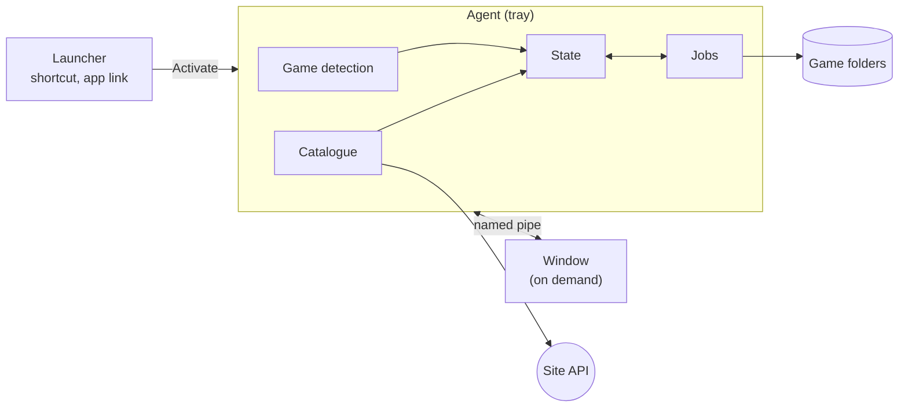

# Architecture

JustModIt Manager finds the games a player installed through stores and launchers, installs and updates what a
JustModIt site offers for them, and can undo every change, even offline. The repository builds two apps on it: the
generic JustModIt Manager and Menadżer Spolszczeń for [Baza Spolszczeń](https://bazaspolszczen.pl).

Three requirements shape most of the design:

1. Never hang. Nothing blocking runs on a UI thread.
2. Stay light in the tray. The app runs all the time, so its idle memory matters most.
3. Never damage a game. Every change to game files is journaled and reversible.

## Overview

The agent lives in the tray and does all the work. The window is a separate process the agent starts when needed; it
renders the agent's state and sends commands back. A launcher only passes its request on to the agent and exits.

| Page | Covers |
|---|---|
| [Processes](processes.md) | the agent, the window and the launcher, and how they talk |
| [Game detection](game-detection.md) | finding games in Steam, GOG and the Epic Games Store |
| [Catalogue and downloads](catalogue-and-downloads.md) | reading the site, matching games, choosing files, counted downloads |
| [Installs](installs.md) | packages, the install engine, jobs and automation |
| [Package creator](package-creator.md) | building packages from a folder of changed files |
| [UI](ui.md) | the window, its screens and its texts |
| [Apps](apps.md) | how an app is put together, and what it sends where |

## Projects

| Project | Role |
|---|---|
| `Core` | the engine: detection, catalogue, packages, installs, jobs, settings. No UI, no user-facing text |
| `Platform.Windows` | Windows implementations of Core's interfaces |
| `Protocol` | messages and views shared by the agent and the window |
| `Agent` | tray, notifications, updates, the pipe server |
| `Ui` | the Avalonia window |
| `Creator` | the package creator |
| `Localization` | texts and formatting |
| `Host` | shared startup |
| `JustModIt.Manager`, `MenadzerSpolszczen` | the two apps |

`Core` depends on nothing but .NET. The window never runs engine code: everything goes through the agent. Everything
must stay compatible with NativeAOT and trimming.

## Terms

- **Game**: an installed game, keyed by store and id (`steam:620`).
- **Project**: what a team publishes for a game, such as a translation.
- **Release**: a version of a project, with base files and optional add-ons.
- **Package**: a release file as the app installs it, a `.zip` or a [manifest package](../package-format.md).
- **Install**: one project installed in one game, with its backups and journal.
