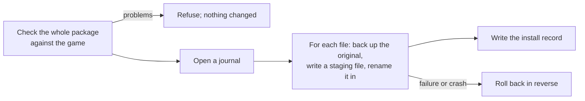

# Installs

## Packages

A package is a `.zip` laid out like the game, or a manifest package with ordered copy, patch (xdelta3), rename and
delete operations. The [package format](../package-format.md) describes it. Every archive is validated before anything
happens: no paths outside the game, no links, size limits.

## The install engine

- Before changing anything, the engine replays the package over the game in memory and reports every problem at once:
  missing files, locked files, a running game, too little space.
- Originals go to a backup folder (by default a hidden folder in the game, so a move is instant). New content is written
  next to the target and renamed in.
- Every step is journaled. An install that a crash interrupted is rolled back at the next start.
- Uninstalling puts the originals back, but never overwrites a file the store changed after the install.
- Updates and repairs uninstall and install again, and put the previous release back if anything fails.

## Jobs and automation

One state coordinator owns the agent's state in a single loop, so nothing needs locks and nothing waits on disk or
network inside it. Every change to a game runs as a job, one per game at a time. Jobs wait for the game to close and
the store to finish its work before they write.

The automation can install new translations, apply updates and repair installs that a game update broke. It never
switches a player's choice, never installs into a game that officially offers the target language, and turns itself
off for a game the player changed by hand.

Code: `Core/Packages/`, `Core/Installation/`, `Core/Patching/`, `Core/State/`, `Core/Jobs/`, `Core/Automation/`.
